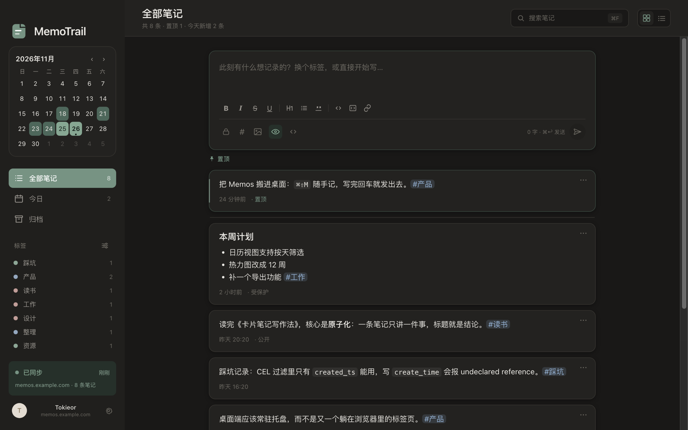
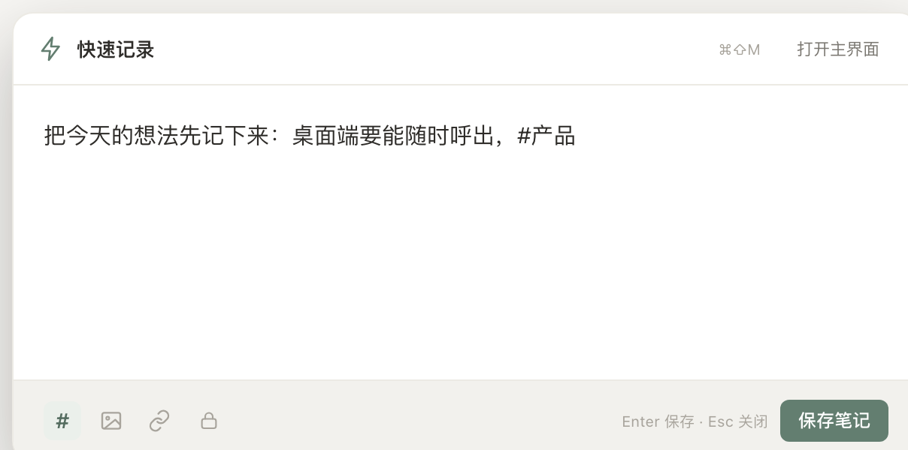

# MemoTrail

**把 Memos 装进桌面：随时唤出、写完就走。**

MemoTrail 是 [Memos](https://github.com/usememos/memos) 的第三方桌面客户端（macOS / Windows / Linux）。它不替代你的服务器，只把「记一条」这件事从浏览器标签页里拿出来，变成一个常驻托盘的原生窗口。

[](https://github.com/Tokieor/memotrail/releases/latest)
[](LICENSE)


---

## 为什么用它

Memos 官方只有 Web / PWA。浏览器里记一条笔记，意味着：切窗口、找标签页、等加载、再切回来。MemoTrail 把这条路缩短到一次快捷键。

| | 浏览器标签页 | MemoTrail |
|---|---|---|
| 记一条笔记 | 切窗口 → 找标签 → 加载 → 写 | 任意界面 `⌘⇧M` → 写 → `Enter` |
| 常驻 | 关掉就没了 | 托盘常驻，菜单里随时打开主窗口或唤起快速记录（macOS 关窗后应用仍在运行） |
| 草稿 | 刷新即丢 | 主输入框与快速记录窗都本地存草稿 |
| 令牌 | 浏览器里到处是 cookie | access token 只在主进程，refresh token 用系统钥匙串（`safeStorage`）加密落盘 |
| 附件 | 上传后走浏览器 cookie | 粘贴/拖拽上传，图片经 `memotrail://` 私有协议带鉴权加载 |
| 观感 | 一套配色 | 经典 / 简约 × 浅色 / 深色 / 跟随系统，共四套 |

其它顺手的地方：

- **原生快捷键**：`⌘N` 新建、`⌘F` 搜索、`⌘R` 刷新、`⌘↩` 发送，提示文字会按当前系统显示（macOS 显示 `⌘`，Windows/Linux 显示 `Ctrl`）。
- **记得你的窗口**：上次关掉时的尺寸会被记住（最小 760×460，可以缩得很小）。
- **侧栏两种卡片**：最近 12 周热力图，或月历——点某一天直接筛出当天的笔记。
- **标签就在正文里**：`#标签` 在渲染后是蓝色胶囊，点一下即筛选；输入 `#` 会弹出候选，支持 `↑↓` + `Enter` 或鼠标点选。
- **没有遥测**：除了你自己的 Memos 服务器，不发任何请求。

## 截图

| 深色 + 月历 | 快速记录（`⌘⇧M`） |
|---|---|
|  |  |


> 截图中的服务器地址与笔记内容为示例数据。

## 下载

到 [Releases](https://github.com/Tokieor/memotrail/releases/latest) 取对应平台的包：

| 平台 | 文件 |
|---|---|
| macOS（Apple Silicon） | `MemoTrail-<版本>-arm64.dmg` |
| macOS（Intel） | `MemoTrail-<版本>-x64.dmg` |
| Windows x64 | `MemoTrail-<版本>-x64.exe` |
| Linux x64 | `MemoTrail-<版本>-x86_64.AppImage` |

包**未签名也未公证**（构建时只做 ad-hoc 签名），所以 macOS 首次打开会被 Gatekeeper 拦下。

**macOS 安装步骤**

1. 打开 dmg，把 `MemoTrail.app` 拖进「应用程序」文件夹（只双击 dmg 里的 app 不会出现在启动台）；
2. 在「应用程序」里**右键 →「打开」**；
3. 如果提示「Apple 无法验证」/「已损坏」，到 **系统设置 → 隐私与安全性**，页面下方会有「仍要打开 MemoTrail」，点它并输入密码；
4. 或者直接用命令行清掉隔离标记，之后双击就能开：

```bash
xattr -dr com.apple.quarantine /Applications/MemoTrail.app
```

> 首次连局域网里的 Memos 服务器时，macOS 会弹「MemoTrail 想要查找并连接到本地网络上的设备」，必须允许，否则会报 `ERR_ADDRESS_UNREACHABLE`。

Linux：

```bash
chmod +x MemoTrail-*.AppImage && ./MemoTrail-*.AppImage
```

## 连接服务器

首次启动填入 Memos 服务器地址与账号密码：

- 公网：`https://memos.example.com`
- 局域网：`http://192.168.1.10:5230`（注意是 `http://` 还是 `https://`，端口是否被反代改过）

客户端对接 Memos 的 `/api/v1`（已在 **Memos 0.31.x** 上验证），会话过期会自动用 refresh token 换新，无需重新登录。

> **macOS 15+ 的「本地网络」权限**：应用首次访问局域网地址会失败（`ERR_ADDRESS_UNREACHABLE`），需要到 **系统设置 → 隐私与安全性 → 本地网络** 里勾选 MemoTrail。仓库已在 `electron-builder.yml` 的 `mac.extendInfo` 中声明 `NSLocalNetworkUsageDescription`。

## 快捷键

| 操作 | macOS | Windows / Linux |
|---|---|---|
| 唤起快速记录 | `⌘⇧M`（可在设置里录制） | `Ctrl+Shift+M` |
| 新建笔记 | `⌘N` | `Ctrl+N` |
| 搜索 | `⌘F` | `Ctrl+F` |
| 刷新时间线 | `⌘R` | `Ctrl+R` |
| 发送 / 保存 | `⌘↩` | `Ctrl+Enter` |
| 收起快速记录 | `Esc` | `Esc` |

托盘图标：左键直接打开主窗口，右键（macOS 上也可 `Control`+点击）弹出菜单。

## 开发

需要 Node.js ≥ 22.12。

```bash
npm install
npm run dev        # 开发模式
npm run typecheck  # 类型检查
npm run build      # 编译到 out/
```

技术栈：Electron 44 + React 18 + TypeScript + Vite（electron-vite），打包用 electron-builder；结构与 [Vicu](https://github.com/rendyhd/Vicu) 同源。

```
src/
  main/       主进程：窗口、托盘、全局快捷键、IPC、Memos 客户端、私有协议
  preload/    contextBridge 暴露的 window.api
  renderer/   React 界面（时间线、编辑器、快速记录、设置）
  shared/     主进程与渲染进程共用的类型
```

## 打包

```bash
npm run dist:mac    # dmg，当前机器架构
npm run dist:win    # nsis 安装包
npm run dist:linux  # AppImage
```

产物在 `dist/`。

CI 见 [`.github/workflows/release.yml`](.github/workflows/release.yml)：**只在推送 `v*` 标签时触发**（也可手动 `workflow_dispatch`），四个平台并行构建，完成后自动把产物挂到对应 Release。平时提交不会触发，也不消耗 Actions 分钟数。

发新版本：

```bash
npm version 0.2.0 --no-git-tag-version
git commit -am "chore: 0.2.0" && git push
git tag -a v0.2.0 -m "MemoTrail v0.2.0" && git push origin v0.2.0
```

## 与上游的关系

MemoTrail 是 [usememos/memos](https://github.com/usememos/memos) 的**非官方**桌面客户端，通过其公开 HTTP API 通信，与 Memos 项目及其作者没有隶属关系；Memos 本身的 bug 与功能建议请反馈给上游。

界面与工程结构参考了 [rendyhd/Vicu](https://github.com/rendyhd/Vicu)（MIT），打包链路（electron-vite + electron-builder + GitHub Actions）与其同源。

## 许可证

MIT。Memos 与 Vicu 亦为 MIT。
